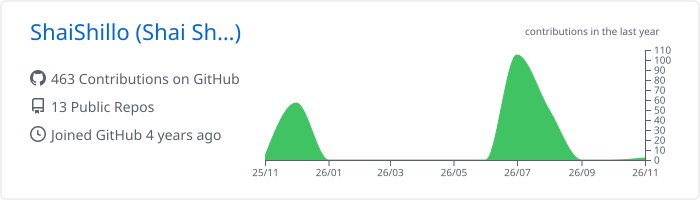
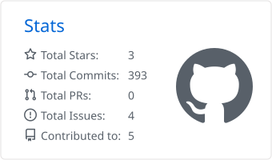
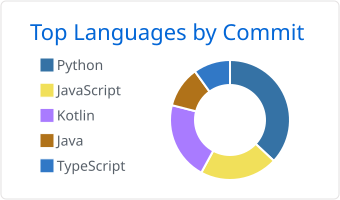

<h1>Hi, I'm Shai Shillo </h1>

<a href="https://git.io/typing-svg">
  <picture>
    <source media="(prefers-color-scheme: dark)" srcset="https://readme-typing-svg.demolab.com?font=Fira+Code&weight=500&size=20&duration=3000&pause=1200&center=true&vCenter=true&width=620&height=40&lines=Backend-oriented+Full-Stack+Engineer;Event-driven+systems+%C2%B7+Kafka+%C2%B7+GCP+%C2%B7+AWS;Bringing+AI+agents+into+production;MCP+%C2%B7+LangGraph+%C2%B7+RAG&color=FFFFFF" />
    
  </picture>
</a>

  
  
  
  

##  About Me

Full-stack (backend-oriented) software engineer building **distributed, event-driven cloud systems** — Kafka, REST APIs, Docker, GCP, AWS. I own services end-to-end, from design to production observability, integrate complex third-party systems, and bring **AI agents into production**.

- 🔭 **Focus:** MCP servers, LangGraph / LangChain agents with Human-in-the-Loop, RAG & vector search, Kafka-based EDA
- 🛠️ **Ship it right:** Docker, CI/CD with GitHub Actions, ELK + OpenTelemetry tracing
- 🎓 **B.Sc. Computer Science, H.I.T.** — GPA 94.85, cum laude, President's List
- 🏆 Scholarships: Motorola Solutions *"Engineering the Future"*, Rupin Mentoring, Holon Municipality
- 💬 **Ask me about:** agentic workflows, event-driven architecture, taking LLM features from demo to production

## 💼 Experience

| Role | Company | Highlights |
| --- | --- | --- |
| **Junior AI Engineer** | Octopus Systems · 2026 | Production MCP server connecting AI agents to enterprise APIs · HITL approval for LangGraph agents · Kafka producer layer + Windmill automation · ELK + OpenTelemetry · semantic analysis engine (LLMs + Zilliz) |
| **Backend Software Engineer** | Siftt.AI · 2025–2026 | AI document-extraction backend from scratch (FastAPI + Google ADK) · Docker on GCP Cloud Run · PostgreSQL / PostGIS with Flyway |
| **Academic Practitioner** | H.I.T. · 2023–2025 | Mentored SE students in Java, OOP design patterns, Git & CI/CD |

## 🚀 Featured Projects

| Project | Stack | Links |
| --- | --- | --- |
| **KPMG GenAI Agent** — Hebrew/English form OCR extraction + retrieval-grounded HMO chatbot; stateless, horizontally scalable | Python · FastAPI · Azure OpenAI · Docker | [Code](https://github.com/ShaiShillo/KPMG-Agent) · [Live demo](https://huggingface.co/spaces/Shai-Shillo/KPMG-Agent) |
| **RAG Monitoring Agent** — natural-language querying of security logs with hybrid semantic + metadata search | Python · Google ADK · Gemini · ChromaDB · Docker Compose | [Code](https://github.com/ShaiShillo/RAG-Monitoring-Agent) · [Live demo](https://huggingface.co/spaces/Shai-Shillo/rag-agent-demo) |
| **ParkerAI** — real-time parking-availability prediction | Node.js · Python · MongoDB · PyTorch · OpenCV | [Code](https://github.com/parkingLotsNotifier) |
| **MERN Admin Dashboard** — responsive admin dashboard with analytics | React · Material UI · Node.js · MongoDB | [Code](https://github.com/ShaiShillo/MERN-Admin-Dashboard) |
| **Fitness Training App** — workouts, exercise search, progress tracking, API sync | Kotlin · Android · MVVM | [Code](https://github.com/ShaiShillo/Fitness-Training-App) |

## 💻 Tech Stack

<table>
  <tr>
    <td></td>
    <td></td>
    <td></td>
    <td></td>
    <td></td>
    <td></td>
  </tr>
  <tr>
    <td></td>
    <td></td>
    <td></td>
    <td></td>
    <td></td>
    <td></td>
  </tr>
  <tr>
    <td></td>
    <td></td>
    <td></td>
    <td></td>
    <td></td>
    <td></td>
  </tr>
  <tr>
    <td></td>
    <td></td>
    <td></td>
    <td></td>
    <td></td>
    <td></td>
  </tr>
  <tr>
    <td></td>
    <td></td>
    <td></td>
    <td></td>
    <td></td>
    <td></td>
  </tr>
  <tr>
    <td></td>
    <td></td>
    <td></td>
    <td></td>
    <td></td>
    <td></td>
  </tr>
  <tr>
    <td></td>
    <td></td>
    <td></td>
    <td></td>
    <td></td>
    <td></td>
  </tr>
</table>

## 📊 GitHub Stats

<!-- Cards are generated daily by .github/workflows/profile-cards.yml and follow the viewer's light/dark theme. -->

<picture>
  <source media="(prefers-color-scheme: dark)" srcset="https://raw.githubusercontent.com/ShaiShillo/ShaiShillo/main/profile-summary-card-output/github_dark/0-profile-details.svg" />
  
</picture>

<picture>
  <source media="(prefers-color-scheme: dark)" srcset="https://raw.githubusercontent.com/ShaiShillo/ShaiShillo/main/profile-summary-card-output/github_dark/3-stats.svg" />
  
</picture>
<picture>
  <source media="(prefers-color-scheme: dark)" srcset="https://raw.githubusercontent.com/ShaiShillo/ShaiShillo/main/profile-summary-card-output/github_dark/2-most-commit-language.svg" />
  
</picture>

