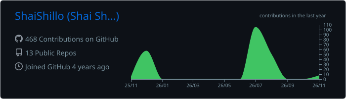
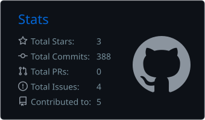
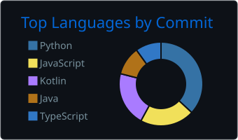

### Hello, 

##  About Me

Full-stack (backend-oriented) software engineer building **distributed, event-driven cloud systems** — Kafka, REST APIs, Docker, GCP, AWS. I own services end-to-end, from design to production observability, integrate complex third-party systems, and bring **AI agents into production**.

- 🔭 **Focus:** MCP servers, LangGraph / LangChain agents with Human-in-the-Loop, RAG & vector search, Kafka-based EDA
- 🛠️ **Ship it right:** Docker, CI/CD with GitHub Actions, ELK + OpenTelemetry tracing
- 🎓 **B.Sc. Computer Science, H.I.T.** — GPA 94.85, cum laude, President's List
- 🏆 Scholarships: Motorola Solutions *"Engineering the Future"*, Rupin Mentoring, Holon Municipality
- 💬 **Ask me about:** agentic workflows, event-driven architecture, taking LLM features from demo to production

## 💼 Experience

| Role | Company | Highlights |
| --- | --- | --- |
| **Junior AI Engineer** | Octopus Systems · 2026 | Production MCP server connecting AI agents to enterprise APIs · HITL approval for LangGraph agents · Kafka producer layer + Windmill automation · ELK + OpenTelemetry · semantic analysis engine (LLMs + Zilliz) |
| **Backend Software Engineer** | Siftt.AI · 2025–2026 | AI document-extraction backend from scratch (FastAPI + Google ADK) · Docker on GCP Cloud Run · PostgreSQL / PostGIS with Flyway |
| **Academic Practitioner** | H.I.T. · 2023–2025 | Mentored SE students in Java, OOP design patterns, Git & CI/CD |

## 🚀 Featured Projects

| Project | Stack | Links |
| --- | --- | --- |
| **KPMG GenAI Agent** — Hebrew/English form OCR extraction + retrieval-grounded HMO chatbot; stateless, horizontally scalable | Python · FastAPI · Azure OpenAI · Docker | [Code](https://github.com/ShaiShillo/KPMG-Agent) · [Live demo](https://huggingface.co/spaces/Shai-Shillo/KPMG-Agent) |
| **RAG Monitoring Agent** — natural-language querying of security logs with hybrid semantic + metadata search | Python · Google ADK · Gemini · ChromaDB · Docker Compose | [Code](https://github.com/ShaiShillo/RAG-Monitoring-Agent) · [Live demo](https://huggingface.co/spaces/Shai-Shillo/rag-agent-demo) |
| **ParkerAI** — real-time parking-availability prediction | Node.js · Python · MongoDB · PyTorch · OpenCV | [Code](https://github.com/parkingLotsNotifier) |
| **MERN Admin Dashboard** — responsive admin dashboard with analytics | React · Material UI · Node.js · MongoDB | [Code](https://github.com/ShaiShillo/MERN-Admin-Dashboard) |
| **Fitness Training App** — workouts, exercise search, progress tracking, API sync | Kotlin · Android · MVVM | [Code](https://github.com/ShaiShillo/Fitness-Training-App) |

## 💻 Tech Stack

**Languages** 

**AI & Agents** 

**Backend & APIs** 

**Data & Messaging** 

**Cloud & DevOps** 

**Frontend & Mobile** 

## 📊 GitHub Stats

<!-- Cards are generated daily by .github/workflows/profile-cards.yml and stored in this repo, so they never depend on a rate-limited public API. -->

